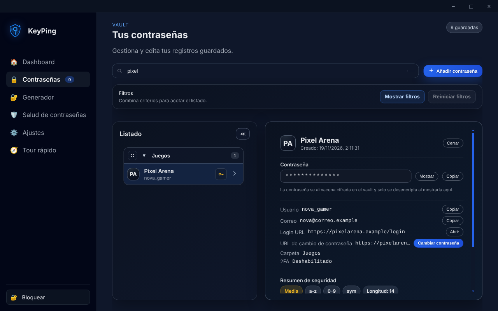
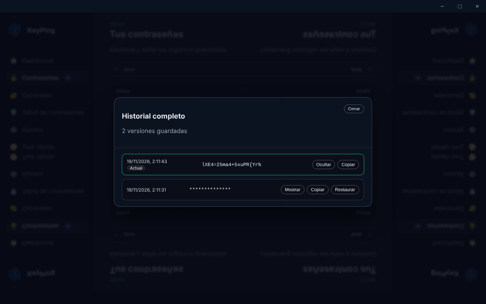
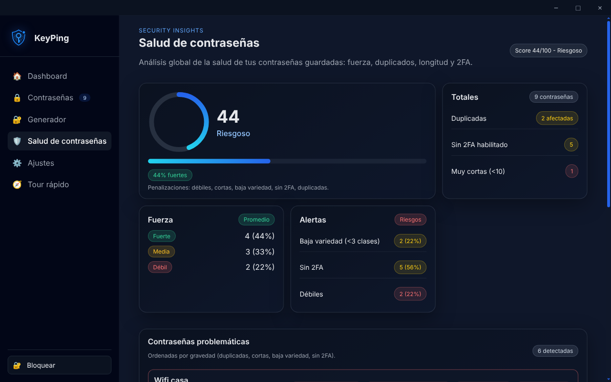
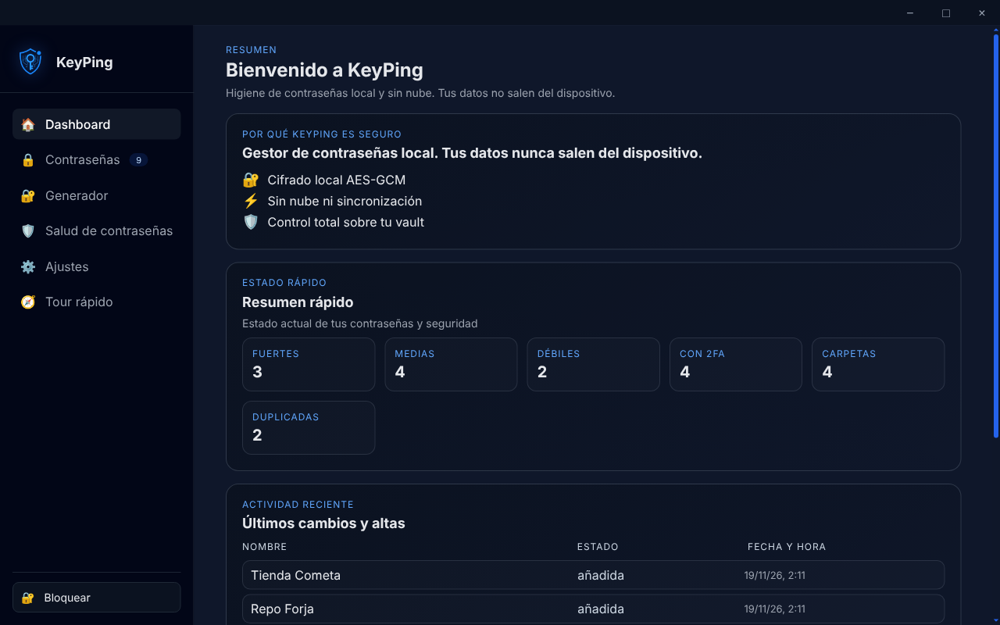

# KeyPing

[English](./README.md) | [Espanol](./README.es.md)

Web: **[keyping.zula.dev](https://keyping.zula.dev)**

**KeyPing es un gestor de contrasenas de escritorio centrado en privacidad, enfocado en detectar contrasenas debiles, reutilizadas y riesgosas, manteniendo todos los datos en local y offline.**

[](https://github.com/Zulaa9/KeyPing/releases)
[](https://github.com/Zulaa9/KeyPing/releases)
[](./keyping-ui)
[](./LICENSE)

## Estado del proyecto

Desarrollo activo. Las funcionalidades base son estables y se estan mejorando de forma continua en UX, seguridad y cobertura de tests.

## Capturas

Versión 1.3.0 con datos inventados.






## Funcionalidades

- Boveda cifrada solo local (AES-256-GCM)
- Deteccion de similitud y reutilizacion de contrasenas
- Analisis y puntuacion de salud de contrasenas
- Historial de versiones por contrasena
- Busqueda y filtros avanzados
- Organizacion por carpetas con drag and drop
- Portapapeles seguro con auto-limpieza y limpieza de historial (Windows en modo best effort)
- Importacion/exportacion cifrada en modo offline
- Auto-actualizaciones via GitHub Releases
- Onboarding interactivo y modo demo
- Interfaz ES / EN

## Por que KeyPing

La mayoria de gestores de contrasenas se centran en almacenamiento y autocompletado.

KeyPing se centra en higiene de contrasenas:

- detectar contrasenas debiles
- identificar credenciales reutilizadas
- destacar patrones de riesgo
- mejorar la seguridad del vault con el tiempo

Todo manteniendo los datos en local y offline.

## Seguridad

### Cifrado local

La boveda se cifra en disco con AES-256-GCM.

### Sin dependencia de nube

No requiere sincronizacion cloud obligatoria, ni almacenamiento externo de secretos, ni cuenta.

### Derivacion PBKDF2

La derivacion usa PBKDF2-HMAC-SHA512 con `600000` iteraciones y sal aleatoria (`kp-auth.json`). Las bovedas de versiones anteriores que usaban el archivo de clave heredado (`120000` iteraciones) se siguen abriendo y pasan a este esquema tras el primer desbloqueo correcto.

### Auto-limpieza del portapapeles

Los secretos copiados se limpian tras el timeout solo si el contenido actual sigue coincidiendo con el secreto copiado. Tambien se limpian al momento cuando se bloquea la boveda.

### Proteccion frente a fuerza bruta

El bloqueo maestro aplica retardos progresivos tras intentos fallidos de desbloqueo. El contador lo guarda el proceso principal y se mantiene al reiniciar la app (maximo una hora).

### Enlaces seguros

Los enlaces de inicio de sesion y de cambio de contrasena solo admiten `http` y `https`. Se rechazan otros esquemas (`javascript:`, `file:`, `data:`...), rutas locales y enlaces con credenciales incrustadas, y siempre se abren en el navegador del sistema.

### Checks de integridad de boveda

La app valida estructura de boveda y detecta anomalias/corrupcion de timestamps.

## Instalacion

Descarga binarios desde GitHub Releases:

- Releases: https://github.com/Zulaa9/KeyPing/releases
- Windows: instalador `.exe` (NSIS)
- Linux: `AppImage`

Por ahora no hay versión para macOS.

Web con enlaces de descarga y cómo verificarlos: https://keyping.zula.dev

## Integridad de releases

Cada release incluye `SHA256SUMS.txt` con el SHA-256 de cada instalador. Comprueba la descarga antes de instalar:

```bash
sha256sum -c --ignore-missing SHA256SUMS.txt
```

En Windows (PowerShell), compara el resultado con la línea de `SHA256SUMS.txt`:

```powershell
Get-FileHash .\KeyPing-Setup-<versión>.exe -Algorithm SHA256
```

### Actualizaciones automáticas firmadas

Desde la 1.3.0 los metadatos de actualización (`latest.yml`, `latest-linux.yml`) van firmados con una clave Ed25519 cuya parte pública está dentro de la app. KeyPing se niega a descargar o instalar una actualización cuya versión, nombres de archivo, tamaños o sumas SHA-512 no estén cubiertos por una firma válida, de modo que un archivo manipulado en una release no puede instalarse automáticamente. Para quien publica: [docs/RELEASE.md](docs/RELEASE.md).

### Firmas GPG (releases antiguas)

Las releases v1.0.0 a v1.0.2 incluyen además `SHA256SUMS.txt.asc`, firmado con la clave GPG `D70937B0AD7411A9E6A66337A5F10A1A37AAEBE9`. Las releases posteriores no llevan firma GPG; usa las sumas de arriba y, para las actualizaciones automáticas, la verificación Ed25519 integrada.

## Arquitectura

- **Frontend**: Angular (componentes standalone)
- **Runtime de escritorio**: Electron
- **Puente IPC**: preload seguro (`contextIsolation` activado)
- **Boveda**: archivo local cifrado gestionado por el proceso principal de Electron

Resumen de flujo:

1. La UI solicita acciones a traves del IPC del preload.
2. El proceso principal valida y ejecuta operaciones seguras.
3. El modulo de boveda cifra/descifra almacenamiento local.
4. La UI recibe metadatos saneados y estado de operacion.

## Desarrollo

Requisitos:

- Node.js 20+
- npm 10+

Ejecucion local:

```bash
cd keyping-ui
npm install
npm run dev
```

Comandos utiles:

- `npm run build` -> build de produccion + empaquetado (Windows)
- `npm run build:linux` -> build de produccion + empaquetado AppImage (Linux)
- `npm run test` -> tests de Angular
- `npm run test:electron` -> tests unitarios de Electron

## Roadmap

- Integraciones opcionales de breach-check (con enfoque de privacidad)
- Mayor cobertura de tests automaticos en IPC/boveda
- Mejor UX de resolucion de conflictos en importacion
- Pipeline de firma y notarizacion en macOS
- Modo portable opcional
- Mas mejoras de accesibilidad y navegacion por teclado

## Contribuir

Se aceptan issues y PRs.

Para reportar bugs, incluye:

- SO y version
- Version de KeyPing
- Pasos de reproduccion
- Comportamiento esperado vs actual

## Licencia

MIT. Consulta [LICENSE](./LICENSE).

## Terceros Y Marcas

- Avisos de terceros: [THIRD_PARTY_NOTICES.md](./THIRD_PARTY_NOTICES.md)
- Aviso de marca y branding: [TRADEMARK.md](./TRADEMARK.md)

## Autor

Unax Zulaika Fuente

- GitHub: https://github.com/Zulaa9
- Proyecto: https://github.com/Zulaa9/KeyPing
