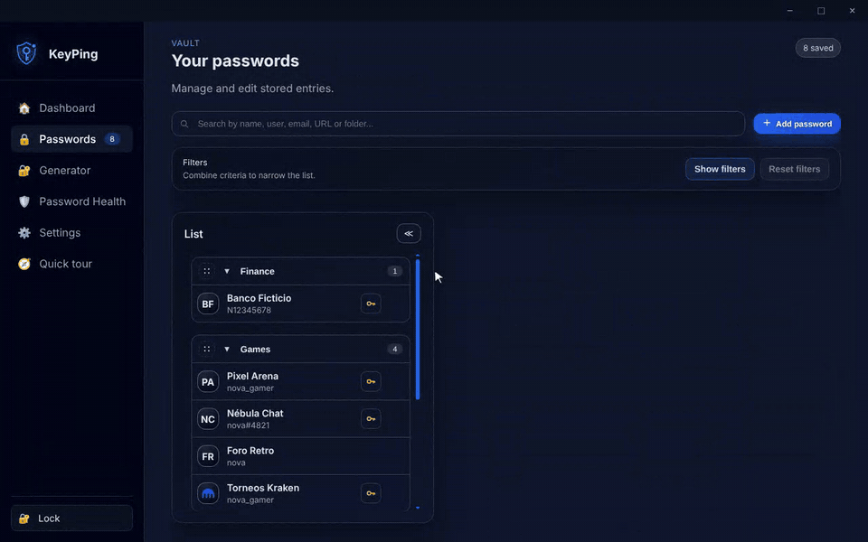
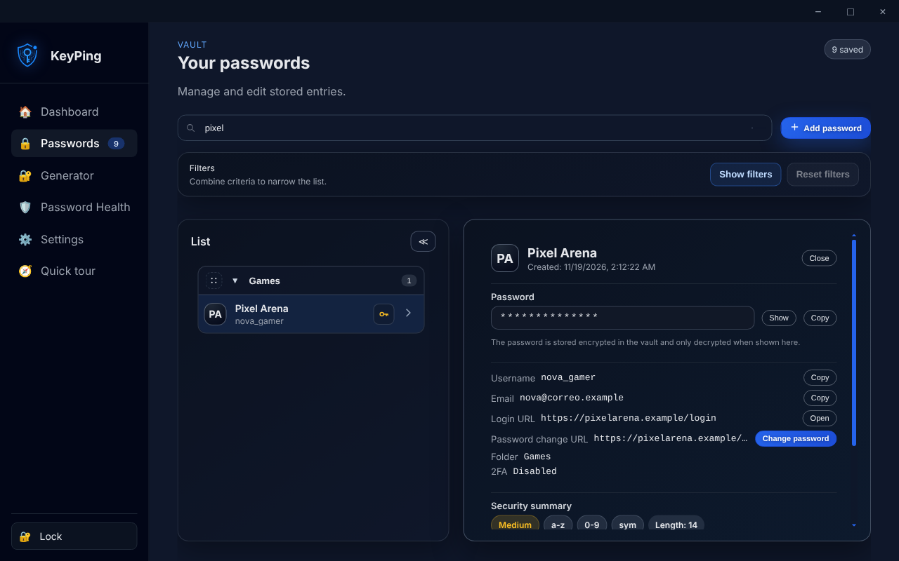
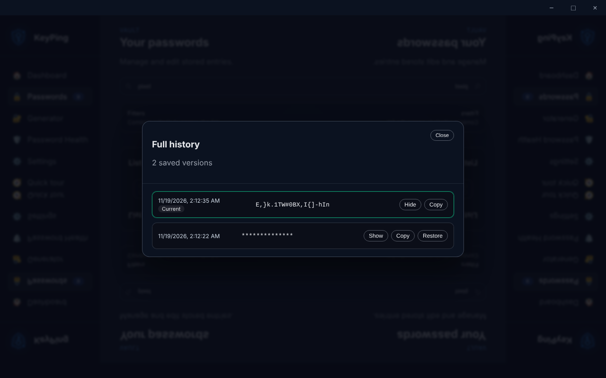
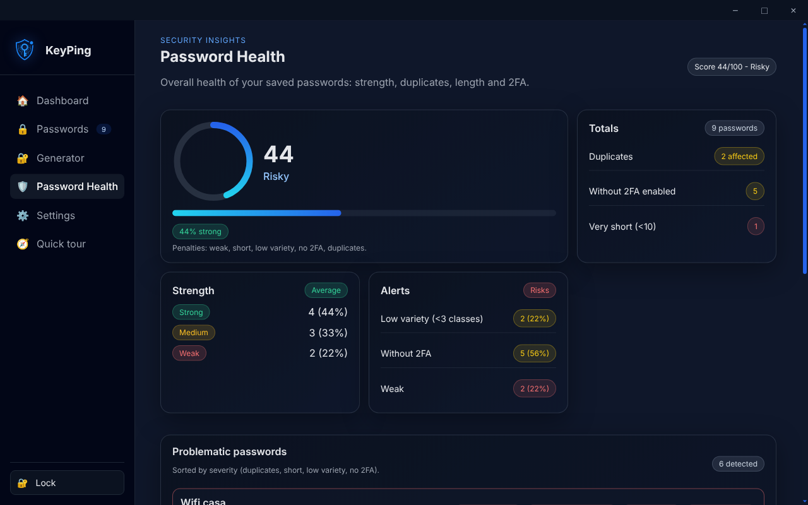
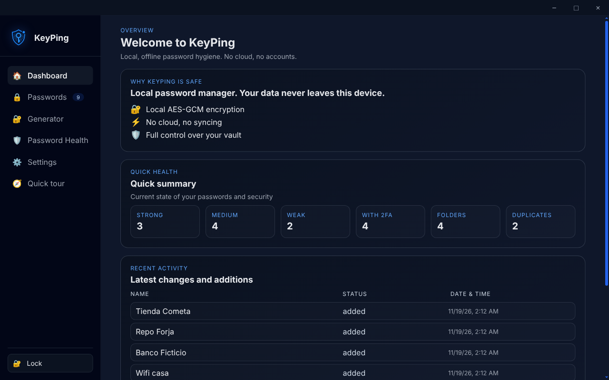
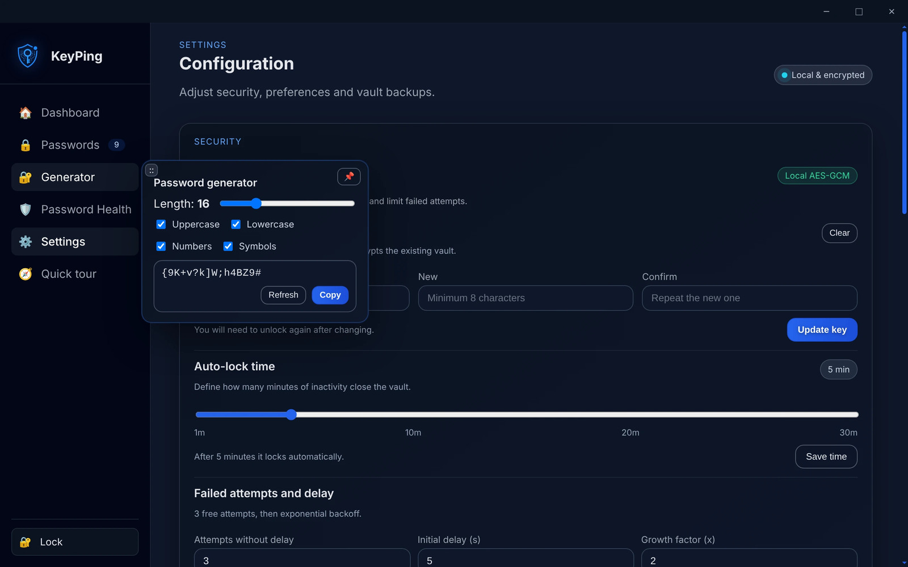

# KeyPing

[English](./README.md) | [Espanol](./README.es.md)

Website: **[keyping.zula.dev](https://keyping.zula.dev)**

**KeyPing is a privacy-first desktop password manager focused on detecting weak, reused, and risky passwords while keeping all data fully local and offline.**

[](https://github.com/Zulaa9/KeyPing/releases)
[](https://github.com/Zulaa9/KeyPing/releases)
[](./keyping-ui)
[](./LICENSE)

## Project Status

Active development. Core features are stable and used daily, with continuous improvements in UX, security, and test coverage.

## Screenshots

Versions 1.3.0 and 1.3.1 with made-up data.

Adding an account with the built-in generator (1.3.1):










## Features

- Local-only encrypted vault (AES-256-GCM)
- Password similarity and reuse detection
- Password health analysis and scoring
- Version history per password
- Advanced filtering and search
- Folder organization with drag and drop
- Secure clipboard with auto-wipe and history cleaning (Windows best effort)
- Offline encrypted import/export
- Auto-updates via GitHub Releases
- Interactive onboarding and demo mode
- ES / EN interface

## Why KeyPing

Most password managers focus on storage and autofill.

KeyPing focuses on password hygiene:

- detecting weak passwords
- identifying reused credentials
- highlighting risky patterns
- improving vault security over time

All while keeping data fully local and offline.

## Security

### Local encryption

Vault data is encrypted on disk using AES-256-GCM.

### No cloud dependency

No mandatory cloud sync, no external secret storage, and no account required.

### PBKDF2 key derivation

Key derivation uses PBKDF2-HMAC-SHA512 with `600000` iterations and a random salt (`kp-auth.json`). Vaults from older versions that used the legacy key file (`120000` iterations) still open and are moved to this scheme after the first successful unlock.

### Clipboard auto-clear

Copied secrets are cleared after timeout only if clipboard content still matches the copied secret. They are also cleared immediately when the vault locks.

### Brute-force delay protection

Master lock applies escalating cooldown delays after failed unlock attempts. The counter is kept by the main process and survives an app restart (capped at one hour).

### Safe links

Login and password-change links only accept `http` and `https`. Other schemes (`javascript:`, `file:`, `data:`...), local paths and links with embedded credentials are rejected, and links always open in the system browser.

### Vault integrity checks

The app validates vault structure and detects corruption/timestamp anomalies.

## Installation

Download binaries from GitHub Releases:

- Releases: https://github.com/Zulaa9/KeyPing/releases
- Windows: `.exe` installer (NSIS)
- Linux: `AppImage`

There is no macOS build at the moment.

Website with download links and verification steps: https://keyping.zula.dev

## Mobile app (Android, in development)

A mobile app designed for the phone lives in `keyping-ui/mobile` (Angular + Capacitor). It shares the vault and export logic with the desktop app (`keyping-ui/core`), so the same `.kpenc` file moves your passwords between computer and phone in both directions. It has no internet permission, blocks screenshots and locks itself when it goes to the background.

It is not published yet. When a release includes `KeyPing-<version>.apk`, it will appear on the website and in `SHA256SUMS.txt`. Details: [keyping-ui/docs/MOVIL.md](keyping-ui/docs/MOVIL.md) (Spanish).

## Release Integrity

Each release includes `SHA256SUMS.txt` with the SHA-256 of every installer. Check your download before installing:

```bash
sha256sum -c --ignore-missing SHA256SUMS.txt
```

On Windows (PowerShell), compare the output with the line in `SHA256SUMS.txt`:

```powershell
Get-FileHash .\KeyPing-Setup-<version>.exe -Algorithm SHA256
```

### Signed auto-updates

Since 1.3.0 the update metadata (`latest.yml`, `latest-linux.yml`) is signed with an Ed25519 key whose public half is built into the app. KeyPing refuses to download or install an update whose version, file names, sizes or SHA-512 hashes are not covered by a valid signature, so a tampered release asset cannot be installed automatically. Maintainers: see [docs/RELEASE.md](docs/RELEASE.md).

### GPG signatures (older releases)

Releases v1.0.0 to v1.0.2 also ship `SHA256SUMS.txt.asc`, signed with the GPG key `D70937B0AD7411A9E6A66337A5F10A1A37AAEBE9`. Later releases do not include a GPG signature; use the checksums above and, for automatic updates, the built-in Ed25519 verification.

## Architecture

- **Frontend**: Angular (standalone components)
- **Desktop runtime**: Electron
- **IPC bridge**: secure preload API (`contextIsolation` enabled)
- **Vault**: encrypted local file managed by Electron main process

Flow summary:

1. UI requests an action through preload IPC.
2. Main process validates and executes secure operations.
3. Vault module encrypts/decrypts local storage.
4. UI receives sanitized metadata and operation state.

## Development

Requirements:

- Node.js 20+
- npm 10+

Run locally:

```bash
cd keyping-ui
npm install
npm run dev
```

Useful commands:

- `npm run build` -> production build + packaging (Windows)
- `npm run build:linux` -> production build + AppImage packaging (Linux)
- `npm run test` -> Angular tests
- `npm run test:electron` -> Electron unit tests
- `npm run test:core` -> shared core and `.kpenc` compatibility tests
- `npm run test:mobile-e2e` -> mobile app end-to-end tests (browser simulator)
- `npm run android:apk` -> Android debug APK (installs as the separate test app "KeyPing pruebas"; requires Android SDK and JDK 21)
- `npm run android:release` -> signed Android APK in `dist/build/` (needs your own upload key in `KEYPING_ANDROID_*` environment variables)

## Roadmap

- Optional breach-check integrations (privacy-preserving approach)
- Expanded IPC/vault automated tests
- Better import conflict resolution UX
- Signed and notarized macOS pipeline
- Optional portable mode
- More accessibility and keyboard navigation polish

## Contributing

Issues and PRs are welcome.

When reporting bugs, include:

- OS and version
- KeyPing version
- Reproduction steps
- Expected vs actual behavior

## License

MIT. See [LICENSE](./LICENSE).

## Third-Party And Trademarks

- Third-party notices: [THIRD_PARTY_NOTICES.md](./THIRD_PARTY_NOTICES.md)
- Trademark and branding notice: [TRADEMARK.md](./TRADEMARK.md)

## Author

**Unax Zulaika Fuente (Zulaa9)**  
Software Systems Engineer  

- GitHub: https://github.com/Zulaa9
- Project: https://github.com/Zulaa9/KeyPing
